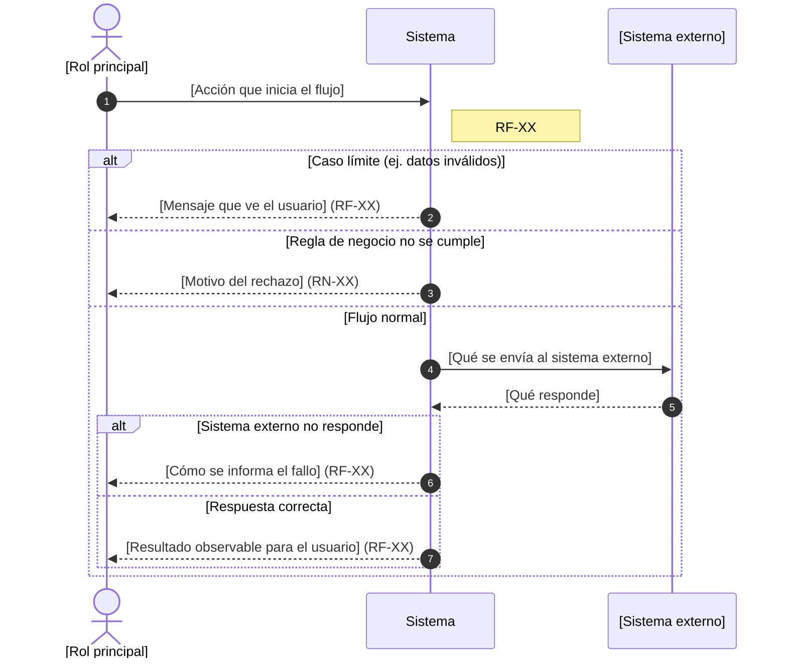

<!--
Diagrama de secuencia de NEGOCIO: specs/NNN-[id-nombre-modulo]/diagramas/HU-XX-negocio.md
Audiencia: cualquier persona (usuarios, negocio, QA, desarrollo).
Reglas:
- Participantes: actores (roles), el "Sistema" como caja negra y los sistemas externos de la sección 7 de spec.md.
- Sin nombres de archivos, clases, tablas ni librerías.
- Mensajes en lenguaje natural; cada mensaje del sistema cita el RF o RN que lo exige.
- Cada caso límite de la sección 8 de spec.md aparece como un bloque alt.
- Sintaxis Mermaid: no uses ";" en los textos (separa instrucciones; escríbelo como #59;), ni la palabra "end" suelta en un mensaje (enciérrala entre paréntesis). El nombre del participante va en una sola línea. No uses `mirrorActors: false` ni ` ` en el nombre: el visor calcula el alto del diagrama con esa fila de abajo y, si falta o el texto se sale de la caja, recorta el dibujo aunque al alejar el zoom se vea completo. En los mensajes sí puedes usar ` `.
- Refleja el flujo vigente: se actualiza en su lugar, no se archiva.
- Se visualiza con la vista previa de Markdown de Cursor o VS Code (Ctrl+Shift+V); no requiere extensiones.
-->

# HU-XX — [Nombre del flujo]

