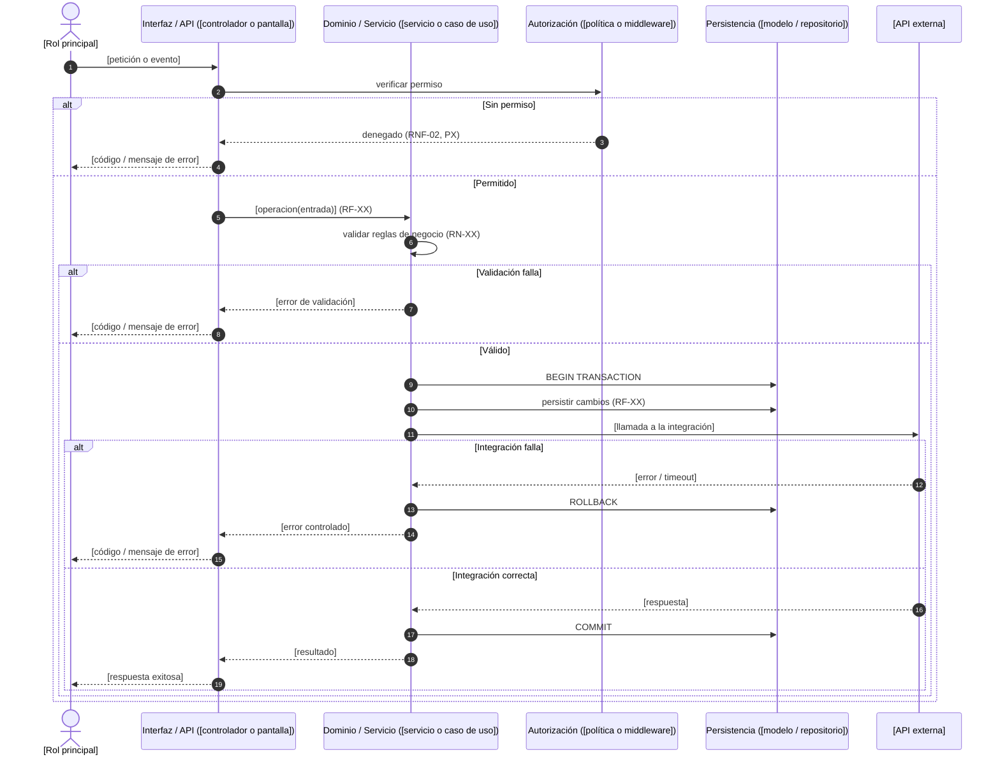

<!--
Diagrama de secuencia TÉCNICO: specs/NNN-[id-nombre-modulo]/diagramas/HU-XX-tecnico.md
Audiencia: desarrollo y QA.
Reglas:
- Mismo flujo que HU-XX-negocio.md, desglosado en las capas de plan.md (sección 1 y 2).
- Los nombres de participantes usan los archivos o componentes reales según `structure` del Perfil técnico.
- Cada llamada relevante cita el RF que implementa; las validaciones citan la propiedad (Px) que protegen.
- Los mismos casos límite del diagrama de negocio aparecen como bloques alt, con su código o tipo de error.
- Participantes: `participant ID as Etiqueta`. El rol (interfaz, servicio, autorización, persistencia) va en la etiqueta, no como icono. `@{ "type": "..." } as Etiqueta` falla en el visor de Cursor: después de `}` espera un salto de línea.
- Sintaxis Mermaid: no uses ";" en los textos (separa instrucciones; escríbelo como #59;), ni la palabra "end" suelta en un mensaje (enciérrala entre paréntesis). El nombre del participante va en una sola línea. No uses `mirrorActors: false` ni ` ` en el nombre: el visor calcula el alto del diagrama con esa fila de abajo y, si falta o el texto se sale de la caja, recorta el dibujo aunque al alejar el zoom se vea completo. En los mensajes sí puedes usar ` `.
- Refleja el flujo vigente: se actualiza en su lugar, no se archiva.
- Se visualiza con la vista previa de Markdown de Cursor o VS Code (Ctrl+Shift+V); no requiere extensiones.
-->

# HU-XX — [Nombre del flujo] (técnico)

