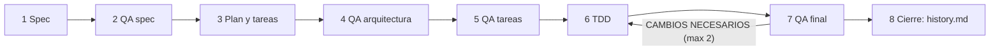

# SDD Kit — Spec-Driven Development para agentes de IA

Flujo de trabajo portátil para que agentes de IA (Cursor) desarrollen software guiados por especificaciones: primero el **qué** y el **por qué** (`spec.md`), luego el **cómo** (`plan.md`), después el **paso a paso** (`tasks.md`), implementación con **TDD estricto** y validación QA en cada etapa.

Es **agnóstico de lenguaje y framework**: funciona igual en Laravel, Python, Node, Go o cualquier otro stack. Lo único que cambia entre proyectos es el bloque `## Perfil técnico` de `AGENTS.md`, que genera `/init`.

Inspirado en el flujo de specs de [Kiro](https://kiro.dev/docs/specs/) (requisitos EARS, diseño, tareas y propiedades de corrección), adaptado a subagentes de Cursor.

Versión actual: ver la primera entrada de [CHANGELOG.md](CHANGELOG.md).

Todo el paquete vive dentro de `.cursor/`; su documentación está en `.cursor/sdd-kit/` (este `README.md` y `CHANGELOG.md`) para no mezclarse con el `README.md` y el `CHANGELOG.md` propios de cada proyecto.

---

## Instalación en un proyecto

1. Copia la carpeta `.cursor/` de este paquete a la raíz del proyecto (si el proyecto ya tiene `.cursor/`, combina las carpetas; el paquete no pisa archivos propios del stack). Es lo único que se copia: el paquete no tiene archivos fuera de `.cursor/`.
2. Edita `.cursor/sdd-kit.md` si este paquete vive en otra ruta o URL (`source`).
3. Ejecuta `/init`:
   - **Proyecto existente**: detecta el stack desde los manifiestos y pregunta solo lo ambiguo.
   - **Proyecto nuevo**: hace una entrevista corta (lenguaje, framework, BD, tests, linter, UI, despliegue) con valores por defecto.
   - Genera `AGENTS.md` (con `## Perfil técnico`), `docs/constitution.md` y `MEMORY.md`.
4. Si el proyecto ya tiene código, ejecuta `/retrofit` para documentarlo en `specs/`.
5. Para cualquier cambio, usa `/sdd`.

Para actualizar un proyecto a una versión nueva del paquete: `/sdd-update`.

---

## Trinidad de contexto

| Archivo | Contiene | Cambia |
|---------|----------|--------|
| `AGENTS.md` | Hechos del proyecto: stack, versiones, estructura, comandos, convenciones, reglas de dominio y `## Perfil técnico` | Cuando cambia el stack |
| `docs/constitution.md` | 6 principios no negociables (puede citar el stack, nunca versiones ni comandos) | Casi nunca |
| `MEMORY.md` | Estado actual, decisiones y aprendizajes | Por iteración |

### Perfil técnico

Los subagentes nunca asumen un comando o framework: leen estas claves de `AGENTS.md`. Si una falta o dice `no configurado`, se detienen y preguntan.

```markdown
## Perfil técnico
- **language**: Python 3.12
- **framework**: FastAPI 0.115
- **database**: PostgreSQL 16
- **test**: pytest
- **test_single**: pytest -k {name}
- **lint**: ruff check . && ruff format --check .
- **run**: uvicorn app.main:app --reload
- **migrate**: alembic upgrade head
- **structure**: código en `app/`; tests en `tests/`
- **ui_check**: no aplica
- **security_audit_skill**: no configurado
```

---

## Estructura de specs

```text
specs/NNN-[id-nombre-modulo]/
├── spec.md     # Índice "Ya implementado" + HU con criterios DADO/CUANDO/ENTONCES, RF (EARS + MoSCoW), RN, RNF, restricciones, integraciones, casos límite, propiedades, trazabilidad
├── plan.md     # Estructura vigente + arquitectura de lo pendiente, trazabilidad RF ↔ archivo, decisiones técnicas
├── tasks.md    # Solo tareas pendientes: prioridad, propiedades validadas, tests asociados, "Hecho cuando"
├── history.md  # Histórico append-only de iteraciones cerradas
└── diagramas/
    ├── HU-01-negocio.puml   # Secuencia para cualquier persona (va con spec.md)
    └── HU-01-tecnico.puml   # Secuencia por capas y archivos (va con plan.md)
```

### Diagramas de secuencia (PlantUML)

Cada historia tiene dos diagramas del mismo flujo:

- **Negocio**: actores, el "Sistema" como caja negra y los sistemas externos, con mensajes en lenguaje natural. Cada caso límite es un bloque `alt` y cada mensaje cita el `RF` o `RN` que lo exige. Lo entiende cualquier persona.
- **Técnico**: el mismo flujo desglosado en las capas del plan (interfaz, servicio, autorización, persistencia, integraciones), con transacciones y errores.

Los diagramas describen el **flujo vigente**: se actualizan en su lugar y no se archivan; `history.md` solo registra qué cambió.

**Para visualizarlos** en Cursor o VS Code, instala la extensión [PlantUML](https://marketplace.visualstudio.com/items?itemName=jebbs.plantuml), abre un `.puml` y pulsa `Alt+D`. Para exportar a PNG o SVG, usa el comando "PlantUML: Export Current Diagram". Los diagramas de secuencia solo necesitan Java instalado; si no lo tienes, configura `plantuml.render` como `PlantUMLServer` en los ajustes de la extensión.

### Documentos activos vs histórico

Para que los agentes no relean todo lo ya hecho en cada interacción:

- `spec.md`, `plan.md` y `tasks.md` contienen **solo lo pendiente**. `spec.md` mantiene un índice `0. Ya implementado` con una línea por RF cerrado.
- Al cerrar una iteración (QA aprobado o `/sdd-archive`), lo completado se **mueve** a `history.md`: HU y RF con su texto completo, propiedades, decisiones, arquitectura y tareas `[x]`. Nunca se borra.
- Los agentes consultan `history.md` solo si el usuario lo pide o si la tarea se parece a algo ya hecho, y siempre buscando por ID o palabra clave, nunca leyéndolo completo.
- Los IDs (`HU`, `RF`, `RN`, `P`, `T`, `S`, `VULN`) continúan desde el máximo histórico y nunca se reutilizan.

---

## Flujo `/sdd` (8 fases)



Cada fase se detiene a pedir aprobación del usuario antes de avanzar.

**Antes de la fase 1**, `/sdd` evalúa si la petición merece especificación. Si es un cambio pequeño que no toca requisitos, reglas de negocio ni contratos (typo, estilos, un bug que viola un RF ya existente), lo dice con su justificación y propone un **cambio directo** (`2-implementer` MODO C), sin spec. El usuario decide.

**Tests que fallan**: nunca se modifica ni se debilita un test existente para que pase. Cada fallo produce un Reporte de Fallo con qué falló, dónde, causa probable con evidencia y una propuesta:
- Corregir ahora, solo si es pequeño y está dentro de la tarea.
- Nueva tarea con test de regresión.
- Pasar por SDD.

El QA revisa en el diff que no se hayan tocado tests sin justificación.

| Subagente | Rol | Escribe en |
|-----------|-----|------------|
| `1-planner` | Especifica (HU + EARS), genera diagramas de secuencia, diseña, genera tareas, valida trazabilidad, genera propiedades, archiva iteraciones | Solo `specs/` |
| `2-implementer` | Una tarea a la vez con TDD (rojo → verde), usando el Perfil técnico | Código y tests |
| `3-qa-reviewer` | Valida spec, arquitectura, tareas e implementación; emite `VEREDICTO: APROBADO` / `CAMBIOS NECESARIOS` | Nada (solo lectura) |

### Calidad exigida
- **5 atributos por requisito**: claro (una sola interpretación), útil (cubre una historia), comprobable (criterio de aceptación o propiedad), trazable (ID y origen) y actualizado (no contradice lo implementado). El QA los evalúa RF por RF.
- **Tipos de requisito**: funcionales (`RF`), no funcionales (`RNF`), restricciones (técnicas y legales), negocio/usuario (`HU` y, si hace falta, `RN`) y datos e integraciones externas.
- **Historias de usuario** (`HU-x`): "Como [rol], quiero [objetivo] para [beneficio]", con criterios de aceptación `CA-x.y` en formato DADO / CUANDO / ENTONCES, cada uno con su test.
- **RF en notación EARS** (CUANDO / MIENTRAS / SI … EL SISTEMA DEBE …), cada uno con la historia que cubre.
- **Reglas de negocio** (`RN-x`, opcionales): solo cuando la regla la usan 2 o más RF, viene de fuera del equipo o es un dato que cambia seguido.
- **Priorización MoSCoW** (`Must` / `Should` / `Could`; `Won't` = Fuera de alcance) en historias y requisitos. Es independiente de la prioridad de tareas, que mide el orden técnico; un RF `Must` debe tener tareas `blocker` o `required`.
- **Propiedades de corrección** formales ("Si X, entonces Y"; "Para todo X, se cumple Y") para RF críticos.
- **Trazabilidad** HU ↔ RF ↔ archivo ↔ test ↔ propiedad.
- **Tareas** con prioridad (`blocker` / `required` / `optional` / `nice-to-have`), propiedades, tests y "Hecho cuando".

---

## Comandos

| Comando | Propósito |
|---------|-----------|
| `/init` | Detecta stack o entrevista; genera Trinidad y Perfil técnico |
| `/sdd` | Flujo completo (8 fases) |
| `/retrofit` | Ingeniería inversa de código existente a `specs/` |
| `/architect` | Subagente planner (modos 1-6) |
| `/implement` | Subagente implementer (TDD) |
| `/review` | Subagente QA reviewer (modos 1-4) |
| `/security` | Auditoría de seguridad (skill del stack o checklist OWASP) e integración en specs |
| `/validation-trace` | Trazabilidad HU ↔ RF ↔ arquitectura ↔ tests |
| `/validation-properties` | Validación y generación de propiedades de corrección |
| `/sdd-archive` | Cierre manual de iteración hacia `history.md` |
| `/sdd-update` | Actualiza el flujo de un proyecto desde este paquete |

---

## Archivos del paquete

Lista usada por `/sdd-update` para saber qué archivos le pertenecen (todo lo demás en `.cursor/` es del proyecto y no se toca):

```text
.cursor/sdd-kit.md
.cursor/sdd-kit/README.md
.cursor/sdd-kit/CHANGELOG.md
.cursor/rules/global-sdd.md
.cursor/subagents/1-planner.md
.cursor/subagents/2-implementer.md
.cursor/subagents/3-qa-reviewer.md
.cursor/commands/sdd.md
.cursor/commands/init.md
.cursor/commands/retrofit.md
.cursor/commands/architect.md
.cursor/commands/implement.md
.cursor/commands/review.md
.cursor/commands/security.md
.cursor/commands/validation-trace.md
.cursor/commands/validation-properties.md
.cursor/commands/sdd-archive.md
.cursor/commands/sdd-update.md
.cursor/skills/sdd-docs-generator/SKILL.md
.cursor/skills/sdd-docs-generator/references/spec-template.md
.cursor/skills/sdd-docs-generator/references/plan-template.md
.cursor/skills/sdd-docs-generator/references/tasks-template.md
.cursor/skills/sdd-docs-generator/references/history-template.md
.cursor/skills/sdd-docs-generator/references/sequence-business-template.puml
.cursor/skills/sdd-docs-generator/references/sequence-technical-template.puml
```

## Qué NO va en este paquete

Skills, comandos o configuración propios de un stack (p. ej. Laravel Boost, auditores de seguridad de un framework, comandos de setup de entorno, `mcp.json`). Se instalan en cada proyecto según su stack; `/init` los sugiere y el Perfil técnico los referencia (p. ej. `security_audit_skill`).

## Cómo evolucionar el paquete

1. Haz el cambio aquí (no en la copia de un proyecto) o tráelo desde el proyecto donde se probó.
2. Agrega una entrada al inicio de `.cursor/sdd-kit/CHANGELOG.md` con la nueva versión y, si cambia la estructura de `specs/`, los pasos de migración.
3. Actualiza `version` en `.cursor/sdd-kit.md`.
4. En cada proyecto, ejecuta `/sdd-update`.
