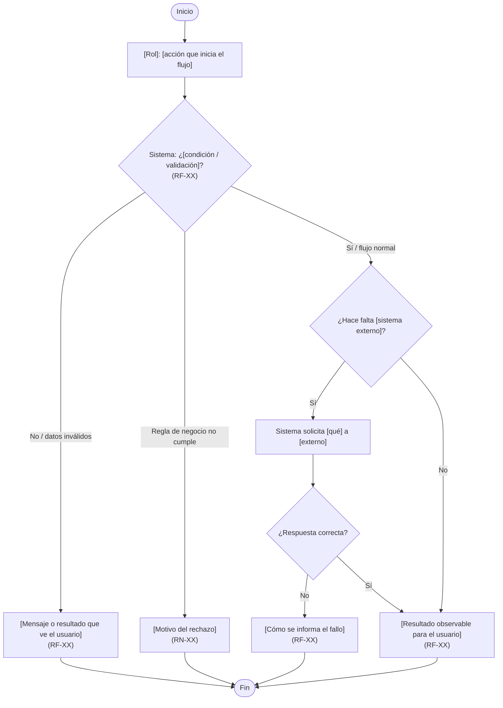

<!--
Diagrama de FLUJO de NEGOCIO (cliente): specs/001-[id-nombre-modulo]/diagramas/HU-XX-negocio.md (ruta real; no uses NNN literal)
Audiencia: cliente / negocio / cualquier persona no técnica.
Reglas:
- Tipo Mermaid: flowchart (TD o LR). NO uses sequenceDiagram aquí.
- Caja negra: el "Sistema" es un paso o grupo de pasos; sin archivos, clases, tablas ni librerías.
- Lenguaje natural (qué ve o decide el usuario / el negocio).
- Decisiones = rombos `{…?}`; cada rama cita el RF o RN que aplica cuando encaje.
- Cada caso límite de la sección 8 de spec.md aparece como rama o nodo de resultado.
- Sintaxis Mermaid: no uses ";" en los textos (escríbelo como #59;); evita la palabra "end" suelta como id de nodo.
- Refleja el flujo vigente: se actualiza en su lugar, no se archiva.
- Se visualiza con la vista previa de Markdown de Cursor o VS Code (Ctrl+Shift+V); no requiere extensiones.
-->

# HU-XX — [Nombre del flujo]

